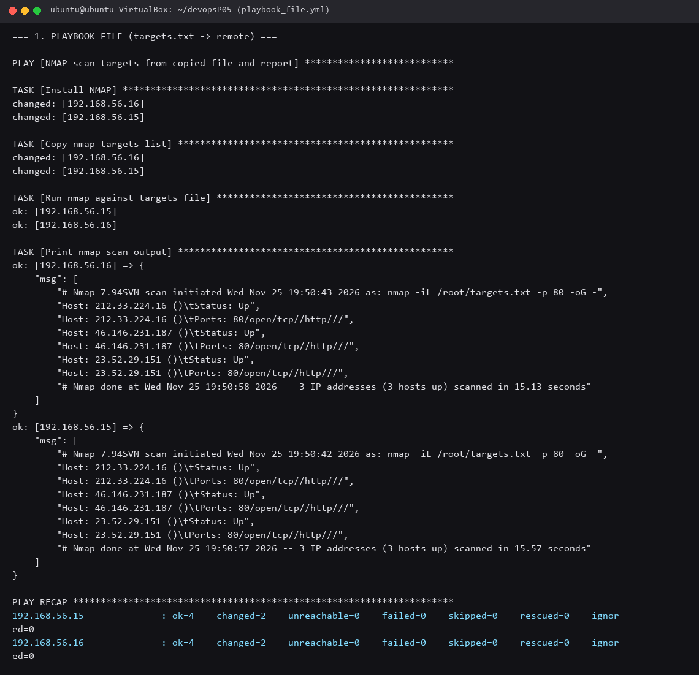
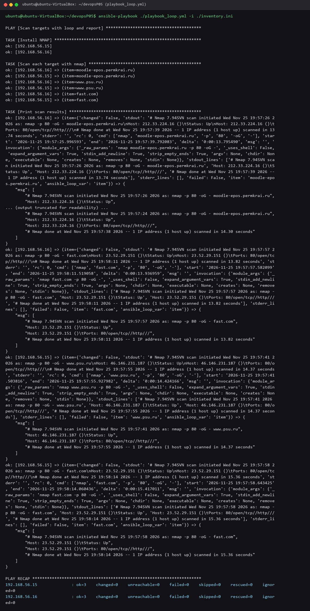

# П05. Работа с переменными в Ansible

## Описание работы
Практическая работа №5 по курсу DevOps:
1. Подготовлен инвентарный файл `inventory.ini` с двумя управляемыми хостами (`192.168.56.16` и `192.168.56.15`).
2. Создан список целевых ресурсов `targets.txt` для проверки доступности порта `80`.
3. Реализованы два варианта Ansible playbook:
   * `playbook_file.yml` — установка утилиты `nmap`, копирование `targets.txt` на управляемые узлы, запуск сканирования (`-iL ~/targets.txt -p 80 -oG -`), сохранение результата в переменную через `register` и вывод через `ansible.builtin.debug`.
   * `playbook_loop.yml` — чтение списка целей с контрольного узла через `lookup('file', './targets.txt').splitlines()`, выполнение задач в цикле `loop`, сбор результатов и вывод через `debug`.

## Структура репозитория
* `README.md` — описание выполненной работы и отчёт со скриншотами.
* `inventory.ini` — инвентарь управляемых хостов.
* `targets.txt` — список целевых доменов для проверки.
* `playbook_file.yml` — playbook с копированием файла целей и регистрацией вывода.
* `playbook_loop.yml` — playbook с циклом `loop` и `lookup`.
* `screenshots/` — скриншоты выполнения плейбуков.

---

## Ход выполнения работы и результаты

### 1. Запуск `playbook_file.yml` (вариант с копированием файла целей)
Плейбук установил `nmap` на оба хоста, скопировал `targets.txt`, выполнил проверку и вывел результаты `stdout_lines` через `debug`:

---

### 2. Запуск `playbook_loop.yml` (вариант с `loop` и `lookup`)
Плейбук выполнил поэлементный обход списка из `targets.txt` через цикл `loop` и вывел собранные результаты `scan_results.results`:

